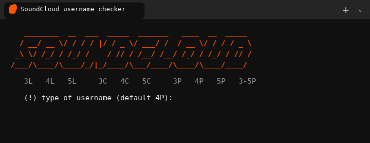
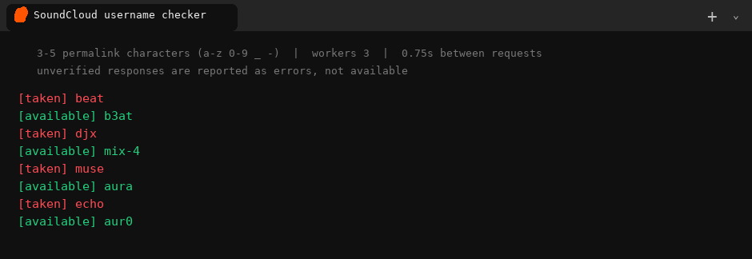

# soundcloud-username-checker

Checks whether SoundCloud profile URLs appear to be in use. Taken names print in red,
free-looking names in green, and free-looking names are appended to `available.txt`.

## usage

1. Install **Python 3.8+** - on Windows, tick `Add python.exe to PATH` in the installer.
2. Run **`run.bat`** (Windows) or `python checker.py` (Windows, macOS, Linux).
3. Enter a username type, or press Enter for the default `4P`.
4. Results classified as available are appended to **`available.txt`**.

Missing libraries (`aiohttp`, `colorama`) are installed on the first start. You can also
install them yourself with `python -m pip install -r requirements.txt`.

Example output (sample responses are mocked for the screenshot; live results depend on SoundCloud):

## types

Type a length and an optional character set:

- `L` - lowercase letters (`a-z`)
- `C` - lowercase letters and digits (`a-z`, `0-9`)
- `P` - SoundCloud profile URL characters (`a-z`, `0-9`, `_`, `-`)

Nothing entered means `4P`.

| type | checks |
|------|--------|
| `4P` | 4-character SoundCloud permalink candidates (default) |
| `3L` `5L` | 3- or 5-letter candidates |
| `3C` `4C` | 3- or 4-character alphanumeric candidates |
| `3-5P` | 3-, 4- and 5-character permalink candidates |
| `3,5L` | 3- and 5-letter candidates |

Lengths from 3 to 25 are accepted. SoundCloud profile URLs allow lowercase letters,
numbers, underscores and hyphens; `soundcloud` itself is not allowed in a profile URL.
See [SoundCloud's profile URL requirements](https://help.soundcloud.com/hc/en-us/articles/115003561828-I-m-having-trouble-saving-changes-to-my-Display-Name-or-Profile-URL).

## notes

- Requests check public profile pages at `soundcloud.com/<candidate>`; no login or API key is used.
- Requests are deliberately paced (three workers, at least 0.75 seconds between request starts).
- Red = profile found, green = no profile found, yellow = rate limited, grey = invalid or unknown.
- Ambiguous responses and site blocks are reported as errors, not as available names.
- Runs through the selected candidate space; press `ctrl+c` to stop at any time. Candidate counts grow exponentially, so large lengths can take a very long time.
- Free-looking names are appended to `available.txt`, so results are retained between runs.
- Availability is advisory only. Reserved or suspended URLs may not be claimable, and SoundCloud can reject a name during signup.

Not affiliated with SoundCloud. Use responsibly and respect SoundCloud's terms and rate limits.
